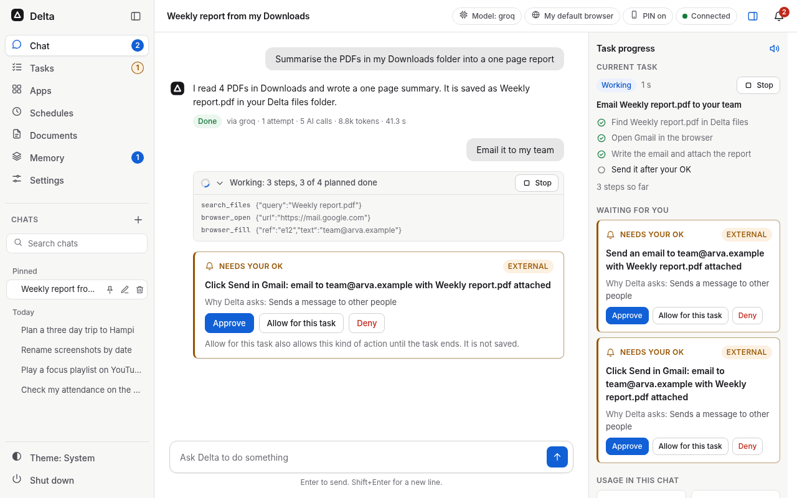

# Project Delta

[](https://github.com/adharshramu12/Project-Delta/actions/workflows/ci.yml)
[](LICENSE)
[](#requirements)

Delta, an open source AI agent I built that does real work on a Windows PC and checks the result before it says done.

You talk to it in the app on your PC or from Telegram on your phone. It plans the task, uses your apps, files and
browser like a person would, asks before anything risky, and then checks what actually happened against the goal.
If something failed, it tells you plainly instead of pretending.



## What it does

- **Dashboard.** One window with Chat, Tasks, Apps, Schedules, Documents, Memory and Settings. A top bar shows the
  AI model, the browser, phone (PIN) protection and the connection. Anything that changes or sends something shows
  up as a card that says exactly what will happen, with Approve, Allow for this task and Deny. Light and dark
  themes follow Windows. More: [docs/UI.md](docs/UI.md).
- **Telegram on your phone.** Send a message or a voice note and Delta does the task on your PC. The "/" menu lists
  every command, grouped by area, and `/help` (or typing `menu`) shows the same list. Old chats are there too:
  `/chats` lists them, `/open` continues one and `/find` searches them. You only ever see your own Telegram chats.
- **Saved logins with captcha handling.** Save a login for a site once (Settings > Logins and watchers, or
  `delta logins add`) and Delta signs in itself. The login is sealed with Windows DPAPI, bound to that exact site,
  and never shown to the AI or written to a log. A simple text captcha on your own account is read by Delta itself,
  with no approval ("let Delta read it" is on by default for every login with a password; you can turn it off per
  login); if it cannot read it in 3 tries, Delta sends the captcha picture to your chat and types your reply. More:
  [docs/LOGINS.md](docs/LOGINS.md).
- **Watchers.** "Watch my portal for exams, timetable and notices." Delta signs in on a schedule (every 6 hours by
  default, never more than once an hour), reads the pages with a saved recipe and no AI, and tells you only what is
  new. More: [docs/WATCHERS.md](docs/WATCHERS.md).
- **Attachments.** Send a picture, PDF, Word (.docx), PowerPoint (.pptx) or text file in the chat or on Telegram.
  Delta reads it on your PC first and sends the AI only a short extract, so it costs far fewer tokens. More:
  [docs/ATTACHMENTS.md](docs/ATTACHMENTS.md).
- **Stop it anytime.** While Delta drives your mouse, keyboard or browser, an orange ring follows the pointer and a
  thin orange border marks the screen. Press Esc twice, press Ctrl+Alt+Shift+S, press Stop in the dashboard, or
  send "stop" or `/stop all` from your phone. Delta lets go at once and closes nothing of yours.
- **Faster app opening and self-heal.** An app that is already open is brought to the front instead of started
  again, and installed apps are indexed so "open X" is quick. When a step fails, Delta works out why and tries a
  safe fix first (find the moved button again, wait for a slow page, close a harmless banner, try another way of
  starting an app). A step that sends, deletes, buys or submits is never retried on its own.
- **Gmail drafts with approval.** "Email Ravi that the review moves to 4 pm." Delta drafts it in your voice and shows
  the whole email with every recipient. It sends only when you press Approve, every single time, at every
  permission level. Edit and Cancel send nothing.
- **Apps and MCP.** Connect Notion, GitHub, Jira and Confluence, Linear, Slack, Sentry, Stripe, Gmail, Google Drive
  and Calendar, Asana, Vercel, Supabase, Hugging Face, Figma or any MCP server you add, all from the Apps page.
  Reading tools run at once; anything that changes something asks first. More: [docs/APPS.md](docs/APPS.md).
- **Human writing.** Chat answers, emails and documents come out in plain Indian English. A check in code (no extra
  AI call) removes long dashes, stock AI phrases and US spellings before you see the text. More:
  [docs/STYLE_AND_IDENTITY.md](docs/STYLE_AND_IDENTITY.md).

Delta also runs scheduled tasks and reminders, keeps a history of every task with resume after a crash, lets you
undo its file changes, remembers what you tell it (encrypted on your PC) and writes PDF and Word documents. The
docs below cover each one.

## Requirements

- **Windows 10 or Windows 11, 64-bit.** Windows on ARM (Snapdragon, Copilot+ PCs) uses the x64 build of Python
  under Windows' own emulation; this has not been tested on a real ARM PC yet.
- **RAM:** 4 GB with a cloud AI. 8 GB or more is better, and 16 GB if you want to run local models.
- **Disk:** about 2 GB free for the install, plus room for local models if you use them.
- **Browser:** Microsoft Edge (every Windows PC has it) or Chrome.
- **Internet** to install, and for cloud AIs, web search, Telegram and connected apps.
- **No administrator rights** needed. Python 3.12 is installed for you if it is missing; Node.js and uv are not
  needed for Delta itself.

## Install

**Steps**

1. **One command.** Open PowerShell (Start menu, type PowerShell) and paste:

   ```powershell
   irm https://raw.githubusercontent.com/adharshramu12/Project-Delta/main/scripts/install.ps1 | iex
   ```

   This works on a new PC where scripts are not allowed, and it does not change that setting. It is also the way
   to install on a PC with Smart App Control on. The installer reuses or installs the official signed Python 3.12
   (64-bit), copies Delta to `%LOCALAPPDATA%\Programs\Delta`, installs its packages (a few minutes), adds a Delta
   icon to the Desktop and Start menu, and adds the `delta` command. The log is at `%TEMP%\delta-install.log`.
2. **Or from a zip.** On GitHub press **Code > Download ZIP**, right-click the zip, choose **Extract All...**, then
   double-click **`Install Delta.cmd`** in the extracted folder. With Smart App Control on, Windows may block a
   file from a downloaded zip; use the command in step 1 instead.
3. **Set up.** The setup wizard opens: pick your AI, set permissions and pair your Telegram.

**Update.** Choose **Update Delta** in the Start menu (Delta folder), or run `delta update --stop` in a new
PowerShell window. `--stop` closes a running Delta first; plain `delta update` asks you to close it yourself. Your
data is kept. If `delta` is not recognised, paste the install command again (it updates in place), or run Delta's
own Python by its full path:

```powershell
& "$env:LOCALAPPDATA\Programs\Delta\.venv\Scripts\python.exe" -m delta update --stop
```

**Uninstall.** This removes Delta and the `delta` command. Your chats and memory stay unless you add `-RemoveData`:

```powershell
powershell -NoProfile -ExecutionPolicy Bypass -File "$env:LOCALAPPDATA\Programs\Delta\scripts\uninstall.ps1"
```

`-ExecutionPolicy Bypass` applies to that one run only.

### Troubleshooting

| What you see | What to do |
|---|---|
| "running scripts is disabled on this system" | Use the `irm` command from step 1; it installs without changing that setting. To run one of Delta's own scripts yourself, use `powershell -NoProfile -ExecutionPolicy Bypass -File <script>` (that run only). |
| Smart App Control blocks `Install Delta.cmd` or the Delta icon | Use the `irm` command from step 1. It installs, or rebuilds Delta on the official signed Python, without running a file from the zip. |
| "Delta's files are not next to this file" | You opened `Install Delta.cmd` inside the zip. Extract the zip first. |
| "Could not create SSL/TLS secure channel" | Older Windows PowerShell. Run `[Net.ServicePointManager]::SecurityProtocol = 3072`, then the `irm` command again. |
| "Some optional parts were not set up" | Delta is installed and works. Paste the command the installer printed under that line. |
| "delta is not recognized" | Open a new PowerShell window. Still not found: paste the install command again, or use the full Python path shown under Update. |
| "No AI model is available" | Add a free Groq key in Setup, sign in to Codex or Claude Code, or start LM Studio or Ollama. |
| The icon does nothing | Read the last lines of `%LOCALAPPDATA%\Delta\logs\service.log`, or run `delta doctor` in a new PowerShell window. |

## Quick start

1. Pick an AI in the setup wizard (see Model providers below). A free Groq or NVIDIA NIM key is enough to start.
2. Pair Telegram if you want to use Delta from your phone, and set a PIN for sensitive actions.
3. Ask something in the chat, for example "open Notepad and write today's to-do list", "summarise this PDF" or
   "what is on my timetable tomorrow?" after saving a login.
4. Approve or deny the cards Delta shows. Close (X) hides the window and Delta keeps listening; Shut down stops
   everything.

From a terminal: `delta doctor` checks your setup, `delta app` opens Delta. The full install guide (options, what is tested, every fix) is in [docs/INSTALL.md](docs/INSTALL.md).

## Safety model

- **Approvals.** Every action is risk-checked. Deleting, sending and anything that leaves your PC needs your yes
  unless you choose autopilot, and even autopilot asks before permanent deletes, changes outside your folders,
  typing into a terminal, and sending or running anything after Delta has read a web page, file or message.
  "Allow for this task" lasts until the task ends and is never saved. Deletes go to the Recycle Bin.
- **PIN.** Sensitive actions from your phone (screenshots, webcam, sign-ins, keys, connecting apps, resuming
  tasks) need your PIN. The PIN is kept only as a salted hash in Windows Credential Manager, and wrong tries lock
  remote control.
- **Captchas.** Delta never bypasses managed captchas: reCAPTCHA, hCaptcha and Cloudflare Turnstile are always
  refused and handed to you. Only simple text captchas on sites you allowed for your own accounts are read, and
  that is off by default.
- **No posting for you.** Delta writes LinkedIn, Medium and Substack drafts but never presses Post; you paste and
  post yourself.
- **Your data stays yours.** Keys live in Windows Credential Manager. Memory, chats and saved logins are encrypted
  with Windows DPAPI, and Delta refuses to save them if encryption is not working. Every decision and tool call
  goes into a signed, hash-chained audit log (`delta audit verify`).

Full threat model and known limits: [SECURITY.md](SECURITY.md).

## Model providers

Use the AI you already have, or run fully offline. Delta routes each request to an available provider and falls
back to the next when one is down, rate limited or out of credits.

| Provider | How you sign in | Cost |
|---|---|---|
| Codex | Your ChatGPT account, through the Codex CLI | Your ChatGPT free or paid plan |
| Claude Code | Your Claude account, through Claude Code | Your Claude subscription |
| Cline | Your Cline account, through cline-cli | Free models available |
| NVIDIA NIM | API key | Free tier |
| Groq | API key | Free tier |
| DeepSeek | API key | Low cost |
| LM Studio, Ollama | Local, on your PC | Free, works offline |

Set them up in Setup, or from Telegram with `/ai`, `/model` and `/keys`. Routes and fallbacks are in
`config/delta.yaml`.

## Docs

- [Architecture](docs/ARCHITECTURE.md) and [add-ons](docs/ADDONS.md)
- [Connected apps and MCP](docs/APPS.md)
- [Saved logins](docs/LOGINS.md) and [watchers](docs/WATCHERS.md)
- [Attachments](docs/ATTACHMENTS.md)
- [Writing style and identity](docs/STYLE_AND_IDENTITY.md)
- [Dashboard design](docs/UI.md)
- [Security](SECURITY.md)
- [What has not been checked on real hardware](docs/NOT_VERIFIED.md)
- [Changelog](CHANGELOG.md) and [contributing](CONTRIBUTING.md)

For developers: `uv sync --extra all`, then `uv run pytest -q`, `uv run ruff check src tests` and `uv run mypy`.
CI runs the full tests, a minimal install, real-browser end-to-end tests and the scripted evals on clean Windows
runners for every push and pull request.

## Licence and trademarks

Project Delta is open source under the **GNU Affero General Public License v3.0 or later** ([LICENSE](LICENSE)).
Anyone can use it, study it, change it and share it, including at work. If you share a modified version, or let
people use one over a network, you must release your source under the same licence and keep the
[NOTICE](NOTICE) credit. Closed-source forks are not allowed. Versions up to and including 0.2.0 were released
under Apache-2.0.

The names "Project Delta" and "ARVA Talks Academy" and the Delta logo are not covered by the licence. Forks,
products and anything that suggests endorsement need written approval: see [TRADEMARKS.md](TRADEMARKS.md).

Built by Adharsh Kumar Bachu, founder of ARVA Talks Academy ([arvatalksacademy.com](https://arvatalksacademy.com/)).
